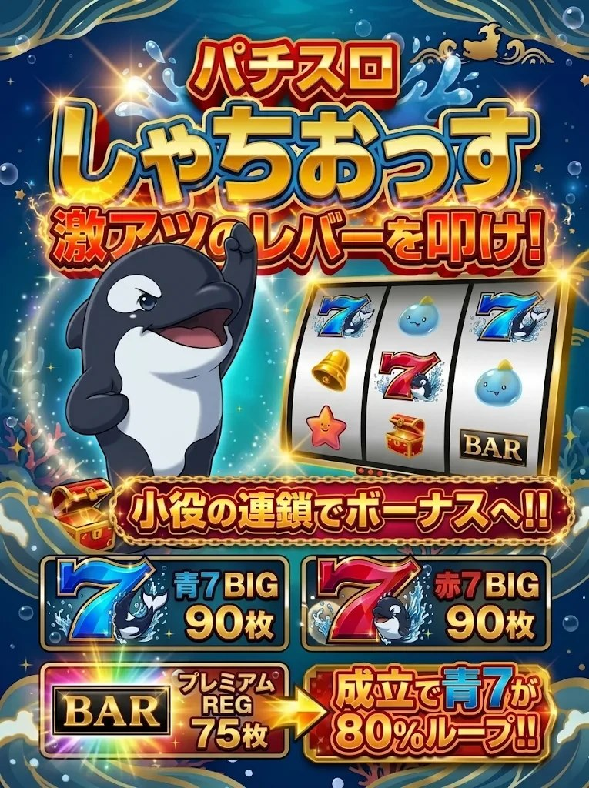
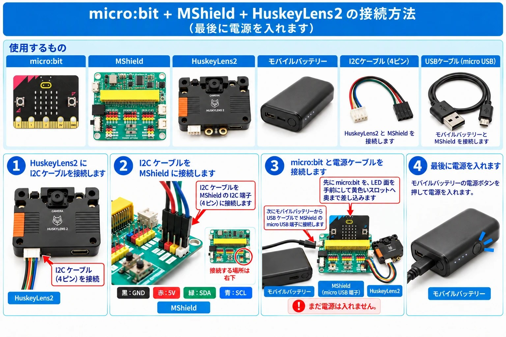

# パチスロ しゃちおっす

iPad・iPhone のブラウザで遊べる、パチスロ風のゲームです。メインキャラはシャチの「しゃちお」。
micro:bit をつなぐとボタンで遊べて、HUSKYLENS 2 をつなぐと、しゃちおがあなたの表情に反応します。

**遊ぶ：https://yuukiokamiya.github.io/shachiossu/**

## 遊び方

1. 「貸出 50枚」でメダルを借ります（足りなくなったら、レバーを叩いたときに自動で借ります）。
2. レバーを叩くと3枚掛けてリールが回ります。
3. 3つの停止ボタンを押してリールを止めます（目押しがずれても、成立している役は最大4コマすべってそろいます）。
4. やめるときは「帰宅」。しゃちおが今日の差枚とひとことを伝えて、メダルと記録がすべて 0 に戻ります。

### ボーナスの条件（小役の連鎖）

| 条件 | ボーナス |
|---|---|
| ベルが3ゲーム連続で成立 | 青7 BIG（90枚） |
| 宝箱が3ゲーム連続で成立 | 赤7 BIG（90枚） |
| リプレイが3ゲーム連続で成立 | しゃちおチャレンジ |

- **しゃちおチャレンジ**：次のゲームでベル・宝箱・チェリーが成立するとプレミアム REG（BAR、75枚）。リプレイならチャレンジ継続、ハズレなら終了。
- **青7ループ**：プレミアム REG のあとは、ボーナスが終わるたびに 80% で青7 BIG が続きます。
- チェリーが成立すると 73% で次のゲームは宝箱、宝箱が成立すると 68% で次のゲームも宝箱。
- 小役が2連続した次のゲーム、しゃちおチャレンジ、青7ループの抽選のときにカットインが出ることがあります（青 → 赤 → 雷の順に期待度アップ）。

### 画面のボタン

| ボタン | はたらき |
|---|---|
| AUTO | 熱い場面（小役2連・チェリー・しゃちおチャレンジ・ボーナス確定）まで自動で回す |
| CHANCE | しゃちおチャレンジ（またはボーナス確定）まで自動で回す |
| スピーカー | 音のオン・オフ |
| グラフ | スランプグラフ（10ゲームごとの差枚） |
| i | 説明のスクロール表示のオン・オフ |
| BLE | micro:bit と Bluetooth でつなぐ |
| カメラ | 記念撮影（3・2・1 で撮影し、リール・グラフ・ボーナス回数と一緒に1枚の写真に） |

## micro:bit と HUSKYLENS 2 をつなぐ

### 必要なもの

- micro:bit V2
- MShield（micro:bit 用の拡張ボード）
- HUSKYLENS 2
- I2C ケーブル（4ピン）
- モバイルバッテリーと USB ケーブル（micro USB）
- iPad / iPhone には **Bluefy**（Web Bluetooth に対応したブラウザ）を入れておきます。Safari では Bluetooth が使えません。

### 接続手順

1. HUSKYLENS 2 に I2C ケーブル（4ピン）を差します。
2. I2C ケーブルを MShield の I2C 端子（右下）に差します。黒：GND、赤：5V、緑：SDA、青：SCL。
3. micro:bit を LED 面を手前にして MShield の黄色いスロットに奥まで差し込み、モバイルバッテリーと MShield を USB ケーブルでつなぎます（まだ電源は入れません）。
4. 最後にモバイルバッテリーの電源を入れます。

HUSKYLENS 2 本体の「Protocol Type」は I2C にしておきます。

### micro:bit のプログラム

`microbit` フォルダに MakeCode（JavaScript）のプログラムがあります。

| ファイル | 内容 |
|---|---|
| `パチスロ_BLEボタン.ts` | ボタンだけ使う |
| `パチスロ_BLEボタン_表情.ts` | ボタン ＋ HUSKYLENS 2 の表情 |

書き込み方は、それぞれのファイルの先頭に書いてあります（拡張機能 bluetooth と HUSKYLENS 2 の修正版 https://github.com/yuukiokamiya/pxt-DFRobot_HuskyLensV2 を追加し、「No Pairing Required」にして書き込み）。

ゲーム画面の「BLE」を押して micro:bit を選ぶとつながります。

| micro:bit | ゲームでのはたらき |
|---|---|
| A ボタン | 止まっていればレバー、回っていれば左の停止 |
| ロゴ（タッチ） | 中の停止 |
| B ボタン | 右の停止 |

## HUSKYLENS 2 を使ったときのゲーム性の変化

HUSKYLENS 2 がプレイヤーの顔の表情を読み取り、しゃちおの反応が変わります。
表情のデータが 3 秒以上届かないときは、HUSKYLENS 2 なしのときと同じ動きに戻ります。

### しゃちおのセリフが表情に反応する

レバーを叩いたとき、半分くらいの確率で、今の表情に合わせたセリフになります（残りはいつものセリフ）。

| 表情 | 小役が成立したゲーム | それ以外 |
|---|---|---|
| 笑顔 | 「キタ！？」「なんか来てる？」 | 「ご機嫌ね～」「いいことあった？」 |
| 怒り・悲しみ | 「ここからっす！」「いくっす！」 | 「しょ、しょんぼり」「元気出そう」 |
| それ以外 | 「今日もお疲れっす」「頑張るっす」「しゃちおっす！」 | 同じ |

ボーナスを持っているときの「青７を狙うんす」などのセリフや、小役2連のあとの熱いセリフ、ボーナス中の掛け声は、表情より優先されます。

### 記念撮影は笑顔で撮る

記念撮影モードでは、しゃちおが「笑うっすよ！」と言って待ちます。
笑顔になると「いい笑顔っす！」に変わり、そこから 3・2・1 のカウントダウンが始まります。
（HUSKYLENS 2 がないときは、すぐにカウントダウンが始まります。）

### 表情が見える

- ゲーム画面の BLE ボタンに、今の表情（😊 😠 😢 🙂）が出ます。
- micro:bit の LED にも表情のアイコンが出ます。顔が映っていないときは ✓ です。

## ファイル

| ファイル | 内容 |
|---|---|
| `index.html` | ゲーム本体（これ1つで動きます） |
| `symbols/` | リールの図柄 |
| `cutin/` | カットインの画像 |
| `shachiossu.webp` | しゃちお（メインキャラ） |
| `background.webp` | 背景 |
| `pamphlet.jpg` / `ogp.jpg` | パンフレット / URL を貼ったときのサムネイル |
| `docs/connection_guide.jpg` | micro:bit と HUSKYLENS 2 の接続方法 |
| `microbit/` | micro:bit のプログラム |
